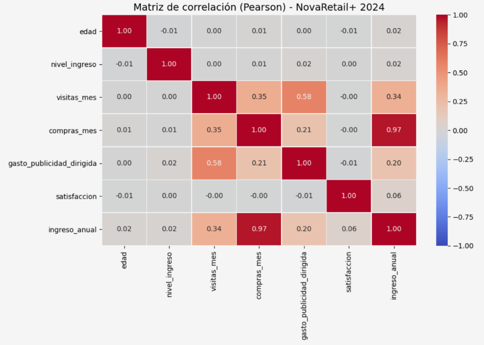
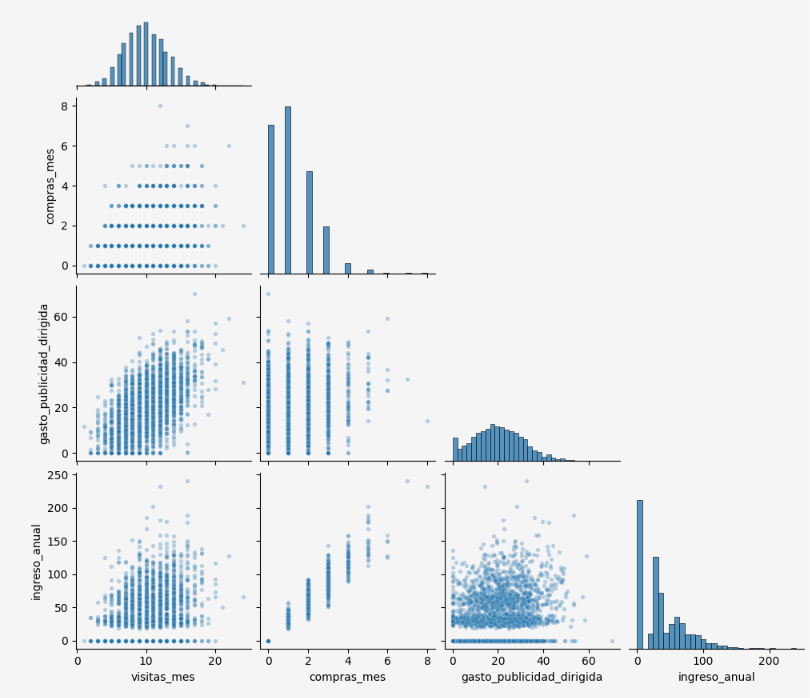

# 🔍 Análisis de Correlación y Drivers de Ingreso del Cliente (Python)

## 🎯 Objetivo del Negocio
Identificar qué factores del comportamiento del cliente están más fuertemente asociados con el **ingreso anual generado** en **NovaRetail+**, plataforma de comercio electrónico con millones de usuarios en Latinoamérica. El análisis, solicitado por el equipo de **Crecimiento y Retención** para el cierre de 2024, busca distinguir las relaciones reales de las engañosas y traducirlas en decisiones accionables, sin caer en interpretaciones causales incorrectas.

## 🛠️ Herramientas y Metodología (Análisis Correlacional)
* **Lenguaje y Librerías:** Python (Pandas, NumPy, Seaborn, Matplotlib, SciPy) en Jupyter Notebook.
* **Calidad y Preparación de Datos:**
  * Auditoría de una base de **15,000 clientes** y 12 variables: sin valores nulos, sin duplicados (`id_cliente` único) y categorías correctamente escritas.
  * Corrección de tipo de dato en `edad` (`float64` → `int`), validando previamente la ausencia de decimales.
  * Clasificación de variables por tipo (numéricas, binarias y categóricas) para seleccionar el coeficiente adecuado.
* **Selección del Coeficiente según el Tipo de Variable:**
  * **Pearson y Spearman:** numérica vs numérica, comparando ambos para detectar relaciones no lineales y el efecto de outliers.
  * **Punto-biserial:** binaria vs numérica (`miembro_premium` y `abandono`).
  * **V de Cramér:** categórica vs categórica (`tipo_dispositivo` y `region`).
* **Visualización y Validación:** Heatmap de correlación, Scatterplots de pares clave, detección de colinealidad (umbral > 0.85) y evaluación de significancia vs. magnitud real.

## 📈 Hallazgos Clave (Insights de Negocio)

1. **La Frecuencia de Compra Domina el Ingreso:**
   * `compras_mes` presenta una correlación de **0.97** con el ingreso anual (Pearson y Spearman), evidenciando **colinealidad**: los clientes con 0 compras generan exactamente 0 de ingreso, y al menos el **25%** de la base no generó ingresos.
2. **Brecha de Conversión entre Visitas y Compras:**
   * Las visitas se asocian solo de forma débil con las compras (**0.35**) y el ingreso (**0.34**). Existen clientes con **15 a 20 visitas mensuales y 0 compras**.
3. **La Publicidad se Asocia con Tráfico, no con Ingreso:**
   * El gasto publicitario se relaciona moderadamente con las visitas (**0.58**), pero apenas con el ingreso (**0.20**). Existe riesgo de **causalidad inversa**: la inversión podría estar dirigida a usuarios que ya eran activos.
4. **Clientes Premium de Mayor Valor:**
   * Los miembros premium (**13.93%** de la base) generan **44.58** de ingreso promedio frente a **35.30** de los no premium (**≈26% más**), sin comprar ni visitar con mayor frecuencia.
5. **Abandono sin Explicación en los Datos:**
   * El **15.07%** de los clientes abandonó la plataforma, pero el abandono no se asocia con ninguna variable analizada (r = -0.003 con el ingreso; V de Cramér < 0.02). Quienes abandonan generaban el mismo ingreso que quienes se quedan.
6. **Variables sin Influencia en el Ingreso:**
   * Satisfacción (**0.056**), ingreso personal (**0.017**), edad (**0.017**), dispositivo y región muestran una asociación prácticamente nula. Pearson y Spearman coincidieron en todas las variables (diferencia máxima de **0.016**), confirmando que los outliers no distorsionan los resultados.

## 💡 Recomendaciones Estratégicas
* **Foco en la Frecuencia de Compra:** Medir el éxito de las iniciativas de crecimiento por su impacto en compras, no solo en tráfico, ya que el ingreso depende casi por completo de ellas.
* **Optimización de la Conversión:** Mejorar recomendaciones, proceso de pago y ofertas personalizadas para convertir a los usuarios activos que visitan pero no compran.
* **Experimento A/B de Publicidad:** Validar el efecto real de la inversión publicitaria sobre compras e ingreso antes de incrementar el presupuesto.
* **Estrategia Premium:** Analizar el ticket promedio de los miembros premium y evaluar experimentalmente si promover la membresía incrementa el ingreso por cliente.
* **Investigación del Abandono:** Recolectar nueva información (encuestas de salida, historial de soporte, precios y tiempos de entrega), ya que las causas del abandono no están en los datos actuales.
* **Estrategias Generales sin Segmentación Geográfica:** Aplicar las iniciativas de forma general, ya que dispositivo, región, edad e ingreso personal no generan diferencias en el valor del cliente.

## ⚠️ Limitaciones
* Análisis correlacional: **no permite establecer relaciones causales**.
* Diferencia de escala temporal: métricas mensuales (visitas y compras) frente a una métrica anual (ingreso).
* Variables faltantes clave: ticket promedio, antigüedad del cliente, canal de adquisición y motivos de abandono.

## 👁️ Visualización de Relaciones entre Variables

